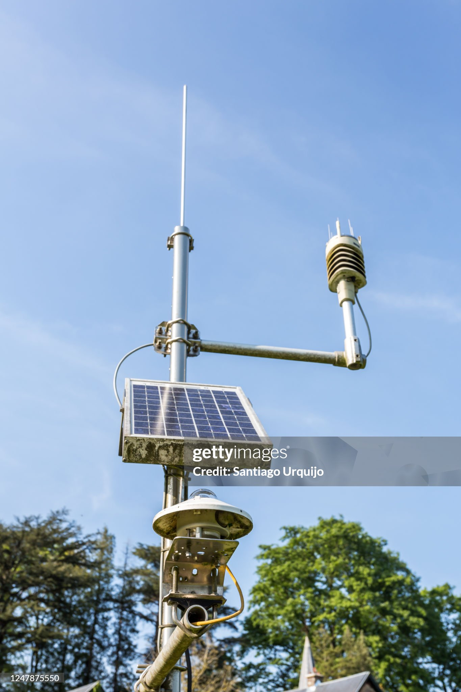
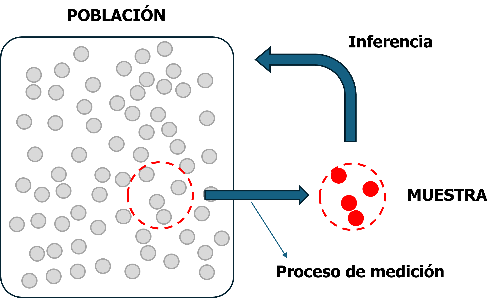
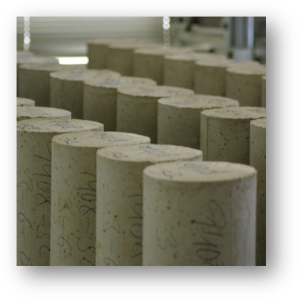
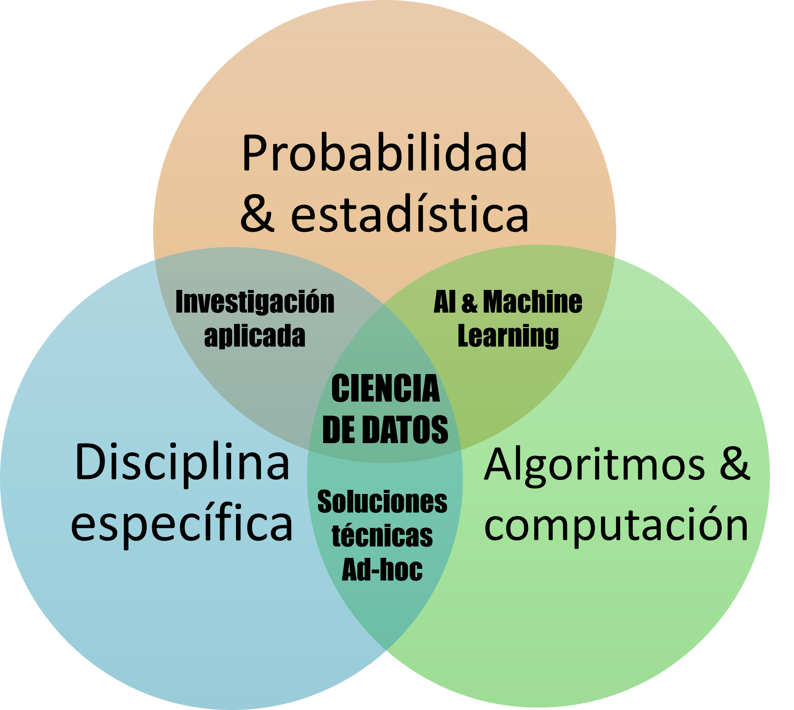
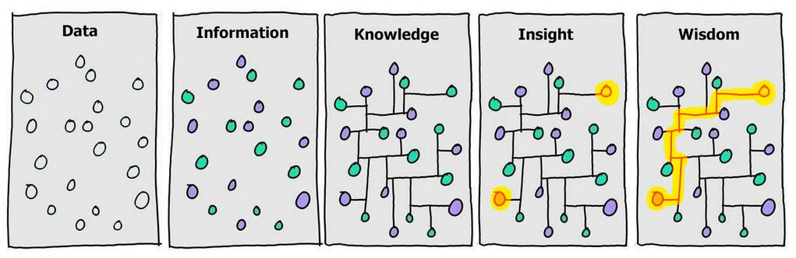

# Introducción

## ¿Qué es la ciencia de datos?

Muy resumidamente puede definirse **Ciencia de Datos** como la "ciencia de aprender de los datos" según el Profesor David Donoho de la Universidad de Stanford[@donoho2017]. Esta definición parece simple, pero refleja dos ideas centrales que aparecerán a lo largo de todo el curso: por un lado, trabajamos con **datos**; por otro, buscamos **aprender** algo a partir de ellos.

Existen incontables definiciones más extensas y específicas del término. Por ejemplo:

:::: {.grid}

::: {.g-col-12 .g-col-md-4}

> Es el estudio de la **extracción generalizable de conocimiento** de los datos
>
> --_Vasant Dahr, New York University[@vasant2013]_

:::

::: {.g-col-12 .g-col-md-4}

> Es el campo inter-disciplinario que usa sistemas computacionales para **extraer conocimiento** de datos estructurados y no estructurados
>
> --_Filippo Chiarello, University of Pisa[@chiarello2021]_

:::

::: {.g-col-12 .g-col-md-4}

> ...obtener datos, entenderlos, procesarlos, **extraer valor**, visualizarlos y comunicarlos...
>
> --_Hal Varian, Google & UC Berkeley[@mckinsey2009]_

:::

::::

Las definiciones anteriores enfatizan aspectos diferentes de la disciplina, pero comparten dos conceptos: **datos** y **extracción de conocimiento**.

Los **datos** son observaciones, o mediciones, de algún aspecto cuantificable de la realidad. A ese aspecto cuantificable lo llamamos **variable**. Por ejemplo, la resistencia de un bulón, la velocidad del viento o el volumen de tránsito son variables cuyos valores podemos medir en distintos objetos o situaciones. Los datos no son _LA REALIDAD_ en sí misma, sino información obtenida a través de un proceso de medición. En este texto, salvo que se indique lo contrario, los términos _datos_, _observaciones_ y _mediciones_ se utilizarán de manera indistinta.

Por otro lado, la expresión "extraer conocimiento" (o "aprender" o "extraer valor") implica, de manera general, obtener conclusiones que puedan utilizarse más allá de las observaciones concretas que fueron medidas.

::: {.callout-tip title="Idea central"}

Extraer conocimiento no significa solamente describir los datos recolectados. En general, buscamos obtener conclusiones que puedan ser generalizadas más allá de las observaciones disponibles.

:::

Una forma simple de ver esta diferencia es preguntarnos qué queremos saber realmente cuando recolectamos datos. En muchas aplicaciones de ingeniería, la cantidad que interesa no puede observarse: ensayamos algunas piezas pero nos interesa las que efectivamente vamos a utilizar; conocemos las intensidades del viento del pasado pero diseñamos para vientos futuros; medimos el tráfico de algunas autopistas en las condiciones actuales pero queremos saber cuál el tráfico sería si impusiéramos un peaje más caro.

:::::: {.card}

::: {.card-header}

Control de calidad en un proceso

:::

::::: {.card-body}

:::: {.grid}

::: {.g-col-12 .g-col-md-6}

Una fábrica produce bulones de acero para la construcción con medidas, materiales y procesos de fabricación estandarizados. En cada turno, se fabrican alrededor de 5.000 bulones de un tipo específico y se quiere conocer la resistencia media a la tracción de los bulones producidos.

No se pueden ensayar todos los bulones porque el ensayo es costoso y, además, los bulones ensayados no pueden venderse. Por eso se selecciona una cantidad reducida de bulones y se mide su resistencia.

Podemos calcular el promedio de las resistencias ensayadas, pero el interés real está en la producción completa.

_Cómo relacionamos el promedio de la muestra con el promedio de toda la población?_

:::

::: {.g-col-12 .g-col-md-6}

{fig-alt="bulones"}

:::

::::

:::::

::::::

:::::: {.card}

::: {.card-header}

Estimación de acciones sobre una estructura

:::

::::: {.card-body}

:::: {.grid}

::: {.g-col-12 .g-col-md-6}

Para el diseño de un puente necesitamos conocer la velocidad máxima del viento que puede actuar sobre la estructura en los próximos años. Para el sitio de emplazamiento contamos con mediciones de los últimos 40 años.

De esas mediciones podemos calcular máximos, mínimos, promedios y muchas otras características. Sin embargo, el interés de diseño no está limitado a esos 40 años: necesitamos razonar sobre vientos que todavía no fueron observados.

_Cómo relacionamos los valores pasados con los posibles valores futuros?_

:::

::: {.g-col-12 .g-col-md-6}

{fig-alt="estación meteorológica"}

:::

::::

:::::

::::::

:::::: {.card}

::: {.card-header}

Relaciones entre variables

:::

::::: {.card-body}

:::: {.grid}

::: {.g-col-12 .g-col-md-6}

Para el diseño de una nueva avenida, una agencia de tránsito está interesada en estimar el volumen de tráfico que usará la vía una vez inaugurada. Puede medir volumen de tráfico, densidad poblacional y ancho de calzada en muchas vías existentes.

A partir de esas observaciones puede estudiar asociaciones entre las variables. Pero la combinación de densidad poblacional y ancho de calzada de la nueva avenida puede no coincidir con ninguna de las vías observadas.

_Cómo predecimos el volumen de tráfico de una avenida no observada a partir de las calles existentes?_

:::

::: {.g-col-12 .g-col-md-6}

{fig-alt="tráfico urbano"}

:::

::::

:::::

::::::

### Muestra, población e inferencia

Los ejemplos anteriores introducen dos grupos de análisis distintos. Por un lado está el conjunto finito de observaciones de las que efectivamente disponemos, que llamamos **muestra**. Por otro, está el universo de objetos u observaciones sobre el que realmente queremos responder una pregunta, que llamamos **población**.

La noción de **población** debe entenderse en un sentido amplio: puede representar objetos físicos existentes, observaciones futuras o incluso configuraciones posibles de un sistema que todavía no fueron observadas.

Llamamos **inferencia** al proceso de generalizar los patrones encontrados en los objetos observados hacia objetos no observados. En otras palabras, la inferencia es el puente que permite utilizar una muestra limitada para responder preguntas sobre una población más amplia.

> **Objetivo general de la ciencia de datos:** responder preguntas sobre el mundo real a partir de un conjunto limitado de observaciones.

{#fig-poblacion width=630px fig-alt="Información sobre el objetivo de la ciencia de datos"}

::::::: {.callout-tip title="Tipos de población"}

En problemas sencillos, la población puede ser un conjunto físico claramente delimitado. En otros problemas, especialmente en ingeniería, la idea de población es más abstracta.

:::::: {.grid}

::::: {.g-col-12 .g-col-md-4}

:::: {.card}

::: {.card-header}

Producción de bulones

:::

::: {.card-body}

La población puede identificarse con todos los bulones fabricados en una tanda determinada.

:::

::::

:::::

::::: {.g-col-12 .g-col-md-4}

:::: {.card}

::: {.card-header}

Velocidades de viento

:::

::: {.card-body}

La muestra puede ser una serie observada de 40 años, mientras que la población de interés incluye observaciones no medidas y futuras.

:::

::::

:::::

::::: {.g-col-12 .g-col-md-4}

:::: {.card}

::: {.card-header}

Tránsito urbano

:::

::: {.card-body}

La población puede incluir configuraciones posibles de densidad poblacional y ancho de calzada que no existen entre las calles actualmente observadas.

:::

::::

:::::

::::::

En todos estos casos, la idea de población cumple la misma función conceptual: especificar el universo al que queremos extender nuestras conclusiones.

:::::::

## ¿Qué queremos aprender de los datos?

Los datos pueden utilizarse con objetivos muy distintos. A veces queremos simplemente **describir lo que observamos**: resumir valores, visualizar su distribución o detectar comportamientos llamativos. En otros casos queremos ir más allá de la muestra y **aprender algo sobre la población**: estimar alguna de sus características, anticipar observaciones no realizadas, estudiar relaciones entre variables o evaluar qué ocurriría si interviniéramos sobre el sistema.

Esta distinción es importante porque el tipo de pregunta determina qué conclusiones podemos extraer de los datos y qué herramientas necesitamos para hacerlo.

### Tipos de preguntas

En términos generales podemos distinguir tres grandes tipos de preguntas: **descriptivas**, **predictivas** y **causales**. La diferencia fundamental entre ellas es el grupo de análisis que queremos describir y cuantificar. Es decir, hasta dónde queremos extender nuestras conclusiones a partir de los datos observados.

#### Preguntas descriptivas

Las preguntas descriptivas se refieren exclusivamente a la **muestra observada**. El objetivo es resumir, explorar o visualizar los datos disponibles sin pretender, todavía, generalizar las conclusiones a una población más amplia.

El **Análisis Exploratorio de Datos (EDA)** se centra justamente en caracterizar los datos obtenidos mediante resúmenes y visualizaciones, con el objetivo de reconocer patrones, comportamientos inusuales y relaciones que puedan resultar relevantes para el análisis posterior.

:::::: {.card}

::: {.card-header}

Exploración de ensayos de hormigón

:::

::::: {.card-body}

:::: {.grid}

::: {.g-col-12 .g-col-md-6}

Una empresa dispone de los resultados de resistencia de una serie de probetas ensayadas en laboratorio. Antes de plantear cualquier generalización sobre el hormigón producido puede preguntarse:

- _¿Cuál fue la resistencia media de las probetas ensayadas?_
- _¿Qué rango de resistencias se observó?_
- _¿Hay valores inusuales?_
- _¿Cómo se distribuyen las resistencias medidas?_

Las respuestas describen las probetas efectivamente ensayadas. Para afirmar que esas características representan también al hormigón no ensayado ya sería necesario realizar inferencia.

:::

::: {.g-col-12 .g-col-md-6}

{fig-alt="probetas de hormigón"}

:::

::::

:::::

::::::

#### Preguntas predictivas

Las preguntas predictivas buscan aprender sobre **aspectos no observados de la misma población o proceso que generó los datos**. En estos problemas utilizamos la muestra para inferir qué podemos esperar de otros elementos, situaciones o características de esa misma población.

Esto incluye preguntas de naturaleza diferente. Por ejemplo, podemos querer estimar una característica global de la población, anticipar el valor de una nueva observación o estudiar cómo se relacionan dos variables dentro de la población.

:::::: {.card}

::: {.card-header}

Caracterización de una población

:::

::::: {.card-body}

:::: {.grid}

::: {.g-col-12 .g-col-md-6}

La fábrica ensaya una pequeña cantidad de bulones y obtiene sus resistencias. El promedio de esas mediciones describe la muestra, pero la cantidad que realmente interesa es la resistencia media de todos los bulones producidos.

_¿Cuál es la resistencia media de la población de bulones?_

:::

::: {.g-col-12 .g-col-md-6}

{fig-alt="bulones"}

:::

::::

:::::

::::::

:::::: {.card}

::: {.card-header}

Predicción del tránsito en una nueva avenida

:::

::::: {.card-body}

:::: {.grid}

::: {.g-col-12 .g-col-md-6}

La agencia de tránsito dispone de mediciones de volumen de tráfico, densidad poblacional y ancho de calzada en vías existentes. Quiere utilizar esos datos para estimar el tránsito en una avenida cuya combinación de características todavía no fue observada.

_¿Cuál será el volumen de tráfico esperado en la nueva avenida?_

:::

::: {.g-col-12 .g-col-md-6}

{fig-alt="tráfico urbano"}

:::

::::

:::::

::::::

:::::: {.card}

::: {.card-header}

Asociación entre variables

:::

::::: {.card-body}

:::: {.grid}

::: {.g-col-12 .g-col-md-6}

Una empresa de fabricación de hormigones busca entender la relación entre la resistencia y distintos factores que pueden afectarla, como la relación agua/cemento, la proporción de agregados o la presencia de superplastificante. Para ello dispone de numerosos ensayos de laboratorio con distintas combinaciones de esas variables.

_¿Existe una asociación entre la relación agua/cemento y la resistencia del hormigón?_

_¿Cuánto varía, en promedio, la resistencia cuando cambia la relación agua/cemento?_

Aunque aquí el interés está puesto en una relación entre variables y no en una predicción puntual, seguimos intentando aprender sobre la población bajo las mismas condiciones que generaron los datos.

:::

::: {.g-col-12 .g-col-md-6}

{fig-alt="mezclas de hormigón"}

:::

::::

:::::

::::::

::: {.callout-note title="Sobre el término “predictivo”"}

En muchos textos, el término **predicción** se utiliza en un sentido más restringido para referirse únicamente a la estimación de nuevas observaciones. En esta introducción utilizaremos **preguntas predictivas** en un sentido más amplio: incluye toda pregunta que busque aprender sobre la población bajo las mismas condiciones que generaron los datos, ya sea para anticipar nuevas observaciones, caracterizar propiedades de la población o estudiar asociaciones entre sus variables.

Más adelante distinguiremos estas situaciones con mayor precisión.

:::

#### Preguntas causales

Las preguntas causales buscan responder qué ocurriría si **interviniéramos** sobre el sistema y modificáramos alguna de las condiciones que generan la población. Por lo tanto, la respuesta ya no se refiere exactamente a la población observada, sino a una **población alternativa** que existiría bajo esa intervención.

:::::: {.card}

::: {.card-header}

Cambio tarifario en un peaje

:::

::::: {.card-body}

:::: {.grid}

::: {.g-col-12 .g-col-md-6}

Una ciudad considera aumentar considerablemente el costo de los peajes sobre una autopista con el objetivo de desalentar el uso del automóvil privado. Los datos históricos permiten estudiar cómo se comporta el tránsito en las condiciones observadas, pero la pregunta de interés se refiere a una condición alternativa.

_¿Qué efecto tendría un aumento del costo del peaje sobre el volumen de tráfico diario?_

Responder esta pregunta exige razonar sobre lo que ocurriría después de modificar deliberadamente una de las condiciones del sistema.

:::

::: {.g-col-12 .g-col-md-6}

{fig-alt="autopista con peaje"}

:::

::::

:::::

::::::

:::: {.card}

::: {.card-header}

Intervención sobre un suelo

:::

::: {.card-body}

Podemos observar asociaciones entre propiedades de un suelo y su resistencia, pero una decisión de ingeniería puede requerir una pregunta diferente: qué ocurriría si modificáramos deliberadamente alguna condición del sistema.

_Si realizáramos una compactación del suelo, ¿cuánto aumentaría su resistencia?_

:::

::::

::: {.callout-tip title="Asociación y causalidad responden preguntas diferentes"}

_¿Cómo se relacionan X e Y en la población observada?_

no es equivalente a

_¿Qué ocurriría con Y si interviniéramos sobre el sistema y modificáramos X?_

Una asociación observada entre variables no implica, por sí sola, una relación causal.

:::

De manera esquemática, los tres tipos de preguntas pueden pensarse así:

> **Descriptivas:** MUESTRA → MUESTRA  
>
> **Predictivas:** MUESTRA → POBLACIÓN  
>
> **Causales:** MUESTRA → POBLACIÓN BAJO INTERVENCIÓN

Los límites entre estas categorías no siempre son completamente nítidos y un mismo conjunto de datos puede utilizarse para responder preguntas diferentes. La diferencia fundamental está en **qué queremos aprender** y, por lo tanto, en qué interpretación pretendemos dar a los resultados.

En las preguntas predictivas y causales aparece una dificultad común: solamente observamos una muestra, pero queremos decir algo sobre cantidades, relaciones o situaciones que no observamos directamente. ¿Cómo podemos hacer esa generalización y qué tan seguras pueden ser nuestras conclusiones?

## ¿Cómo extraemos conocimiento?

El proceso analítico para generalizar (extrapolar) lo medido en una muestra a una población subyacente se conoce como **inferencia**. Este proceso involucra una dificultad fundamental: las observaciones reales presentan, en mayor o menor medida, aleatoriedad y componen solo una parte pequeña de las todas los elementos de la población (entendida como concepto amplio según 1.1). Como consecuencia, nuestras conclusiones sobre la población nunca son completamente ciertas.

### Patrones, variabilidad e incertidumbre

Que una variable tome valores diferentes entre distintas observaciones significa que existe **variabilidad**. Pero variabilidad no es necesariamente sinónimo de aleatoriedad.

Por ejemplo, la secuencia

$$
1,\;2,\;4,\;8,\;16,\ldots
$$

presenta una gran variación entre sus valores, pero sigue un patrón completamente determinístico. Una vez identificado ese patrón, el valor siguiente puede determinarse exactamente.

En las observaciones de sistemas reales, en cambio, suele existir una combinación entre **regularidades o patrones determinísticos** y una componente que no podemos anticipar exactamente para cada observación individual. A esta última la llamaremos **variabilidad aleatoria**.

::: {.callout-tip title="Patrón y variabilidad aleatoria"}

En muchos problemas podemos pensar, de manera conceptual, que las observaciones contienen:

**un patrón sistemático + variabilidad aleatoria**.

El patrón representa aquello que se repite o cambia de manera regular en la población. La variabilidad aleatoria hace que las observaciones individuales no sigan ese patrón de manera exacta.

Uno de los objetivos fundamentales de la inferencia es utilizar una muestra finita para arrojar luz sobre esos patrones subyacentes, sin ignorar la variabilidad aleatoria que los rodea.

:::

La variabilidad aleatoria que observamos en los datos puede tener distintas fuentes. Dos de las más importantes son la **variabilidad inherente de la población** y la **variabilidad introducida por el proceso de medición**.

#### Variabilidad inherente en la población

Incluso bajo condiciones nominalmente iguales, distintos elementos o eventos de una población pueden tomar valores diferentes.

::: {.callout-tip title="Ejemplo: resistencia de probetas"}

Dos probetas fabricadas nominalmente con la misma mezcla de hormigón y curadas bajo condiciones similares no alcanzarán exactamente la misma resistencia. Pequeñas diferencias en los materiales, la preparación, el curado y muchas otras condiciones hacen que la resistencia presente una variabilidad propia de la población.

Aunque pudiéramos medir cada probeta perfectamente, sus resistencias seguirían siendo diferentes.

:::

Esta variabilidad pertenece al fenómeno que queremos estudiar: no surge simplemente porque medimos mal.

#### Variabilidad en el proceso de medición

Las mediciones también presentan variabilidad propia. Si medimos repetidamente una misma magnitud, los valores registrados pueden no ser exactamente iguales debido a la resolución de los instrumentos, ruido electrónico, condiciones ambientales, variaciones del procedimiento u otras imperfecciones del proceso de medición.

::: {.callout-tip title="Ejemplo: medición de desplazamientos"}

Supongamos que medimos repetidamente el desplazamiento de un punto de una estructura sometida a una condición prácticamente constante. Aun si el desplazamiento real permaneciera estable, las lecturas obtenidas por un sensor podrían fluctuar ligeramente alrededor de ese valor.

En este caso, parte de la variabilidad observada proviene del proceso mediante el cual medimos la variable y no de cambios reales en la estructura.

:::

Por lo tanto, las observaciones que vemos son una versión imperfecta de los patrones de la población. Además, la **muestra** contiene solamente una parte de todas las observaciones posibles. Si repitiésemos el proceso de muestreo, probablemente obtendríamos una muestra diferente.

Estas dos características, la existencia de variabilidad aleatoria y el hecho de observar solamente una parte de la población, generan **incertidumbre** sobre aquello que queremos conocer. No sabemos exactamente cuál es la resistencia media de todos los bulones a partir de unas pocas piezas ensayadas; tampoco podemos saber exactamente cuál será la máxima velocidad de viento del próximo año; ni determinar de manera perfecta una relación entre variables a partir de un conjunto limitado y ruidoso de observaciones.

::: {.callout-note title="Variabilidad e incertidumbre no son lo mismo"}

La **variabilidad** describe que las observaciones posibles pueden tomar valores diferentes.

La **variabilidad aleatoria** se refiere a la parte de esas diferencias que no podemos anticipar de manera determinística para cada observación.

La **incertidumbre** describe nuestro conocimiento incompleto sobre alguna cantidad de interés: un patrón de la población, una característica poblacional, una observación futura o el efecto de una intervención.

La variabilidad aleatoria de los datos es una de las principales razones por las que nuestras inferencias son inciertas.

:::

::: {.callout-important title="Más datos no convierten el problema en determinístico"}

Obtener más observaciones puede permitirnos caracterizar con mayor precisión algunos patrones de la población y la propia variabilidad aleatoria, siempre que los datos sean informativos y el proceso de medición sea adecuado.

Sin embargo, más datos **no eliminan la variabilidad aleatoria inherente al fenómeno** ni hacen que una realización futura pueda predecirse exactamente. Tampoco corrigen necesariamente errores sistemáticos del proceso de medición o hipótesis incorrectas sobre el problema.

En los sistemas reales, donde existen variabilidad inherente y mediciones imperfectas, las conclusiones inferenciales deben expresar explícitamente la incertidumbre que permanece.

:::

La consecuencia fundamental es que el proceso inferencial no puede dar certezas donde no las hay. Es decir, no se puede dar una respuesta determinística a un problema que es intrínsecamente aleatorio. Por esta razón, la inferencia lo que busca es cuantificar la incertidumbre sobre las características específicas que queremos conocer sobre la población.

Esto nos lleva a la siguiente pregunta: ¿cómo cuantificamos esa incertidumbre?

### Cuantificando la incertidumbre

La herramienta matemática que utilizamos para cuantificar la incertidumbre es la **probabilidad**.

En el lenguaje cotidiano ya utilizamos la palabra probabilidad para expresar distintos grados de incertidumbre:

- una moneda tiene aproximadamente la misma probabilidad de caer de cada lado;
- podemos hablar de la probabilidad de que una persona mida menos de cierta altura;
- podemos preguntar por la probabilidad de que la resistencia de un suelo supere un determinado valor;
- podemos expresar qué tan probable consideramos que ocurra lluvia mañana.

En ciencia de datos utilizaremos la probabilidad de manera formal para describir la variabilidad aleatoria y, fundamentalmente, para expresar la incertidumbre asociada a nuestras inferencias.

::: {.callout-tip title="Idea central"}

**Las respuestas inferenciales no son solamente valores: son valores o conclusiones acompañados por una cuantificación de su incertidumbre.**

La probabilidad será el lenguaje matemático que utilizaremos para expresar esa incertidumbre.

:::

Más adelante formalizaremos estas ideas mediante variables aleatorias, distribuciones de probabilidad y herramientas de inferencia estadística. Por ahora alcanza con retener la relación conceptual:

> **variabilidad aleatoria + información incompleta → incertidumbre → probabilidad**

### El proceso de la ciencia de datos

La probabilidad y la inferencia estadística son herramientas centrales para aprender de los datos, pero la ciencia de datos moderna abarca un proceso más amplio. Los datos deben obtenerse, almacenarse y procesarse; deben explorarse y visualizarse; las inferencias deben implementarse y evaluarse; y las conclusiones deben interpretarse dentro del problema de ingeniería que motivó el análisis.

Por eso, la ciencia de datos se ubica en la intersección de distintas áreas:

- **probabilidad y estadística**, para representar variabilidad, cuantificar incertidumbre y realizar inferencia;
- **algoritmos, programación y computación**, para manipular datos y aplicar métodos de manera reproducible y eficiente;
- **conocimiento específico del dominio**, para formular preguntas relevantes, reconocer hipótesis razonables e interpretar correctamente los resultados.

{#fig-ciencia-datos width=578px fig-alt="La ciencia de datos como encuentro de distintas especialidades"}

El desarrollo de la computación amplió enormemente el tipo y volumen de datos que pueden analizarse, así como la complejidad de los métodos que pueden aplicarse. Algoritmos capaces de encontrar regularidades en grandes volúmenes de información hicieron posibles aplicaciones que exceden ampliamente los análisis estadísticos tradicionales.

:::::: {.card}

::: {.card-header}

Clasificación de imágenes

:::

::::: {.card-body}

:::: {.grid}

::: {.g-col-12 .g-col-md-6}

En un contexto de planificación urbano-ambiental, un gobierno necesita caracterizar la cobertura y el uso del suelo de una cuenca. Las imágenes satelitales permiten observar grandes extensiones de manera periódica, pero cada imagen contiene una enorme cantidad de información que sería costoso clasificar manualmente.

Un algoritmo puede aprender regularidades a partir de imágenes previamente clasificadas y utilizarlas para caracterizar nuevas imágenes.

_¿Cómo usamos imágenes satelitales ya interpretadas para automatizar la clasificación de imágenes nuevas?_

:::

::: {.g-col-12 .g-col-md-6}

{fig-alt="clasificación de imágenes satelitales"}

:::

::::

:::::

::::::

El proceso completo no debe entenderse como una secuencia rígida sino como un ciclo en el que las etapas se retroalimentan. Una exploración puede llevar a reformular la pregunta; los resultados pueden revelar problemas en los datos; y una conclusión puede exigir obtener nuevas observaciones.

{#fig-somerville width=255px fig-alt="El proceso de la ciencia de datos"}

De manera esquemática, podemos distinguir las siguientes etapas:

1. **Definición del problema.** Plantear la pregunta que queremos responder y delimitar la población y las variables relevantes.
2. **Obtención y preparación de los datos.** Recolectar, almacenar, leer, limpiar y transformar las observaciones necesarias para el análisis.
3. **Exploración de los datos.** Caracterizar la muestra mediante resúmenes y visualizaciones, detectar patrones, valores inusuales y posibles problemas.
4. **Inferencia.** Utilizar las observaciones disponibles para responder preguntas sobre aspectos no observados, cuantificando la incertidumbre asociada a las conclusiones.
5. **Aplicación e interpretación.** Utilizar los resultados para responder la pregunta de interés, comunicar las conclusiones y, cuando corresponda, asistir una decisión de ingeniería.

::: {.callout-tip title="Una idea que atravesará todo el curso"}

La ciencia de datos no consiste solamente en aplicar un algoritmo a un conjunto de datos. El objetivo es extraer conclusiones útiles sobre un problema real a partir de observaciones incompletas e imperfectas, haciendo explícitas las incertidumbres involucradas.

:::

* * *

## Referencias {.unnumbered}

::: {#refs}
:::
